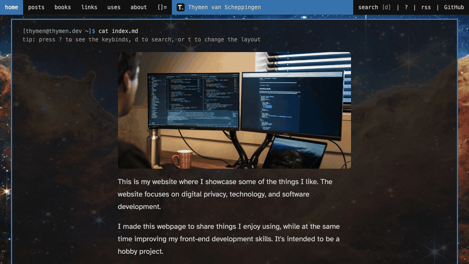

# About this blog

I started this website as a hobby project to learn about
front-end development and CSS styling. My experience is mainly
in back-end development, so I want improve my front-end
development skills. The idea is to create my own little corner
of the internet where I can share some thoughts about topics I
am interested in.

I currently have no social media outside of messaging apps,
because I think social media is bad for me and society in
general. But I still want to have some internet presence, for
example when people want to look me up. That is one of the
reasons why I created this website.

