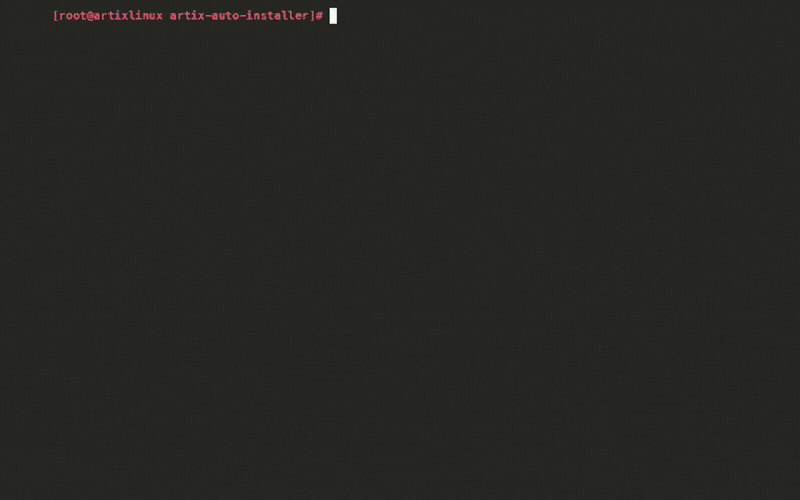

A few months ago I wrote [a tutorial](/blog/artix-install-full-disk-encryption/) on how to install Artix Linux with disk encryption. Since then I have distro-hopped multiple times and spent a lot of time tinkering with my system. Installing a different Linux distro every few weeks takes quite some time.
That is why I have created [a script](https://github.com/tcvscheppingen/artix-auto-installer) to automate the installation of Artix Linux with the Dinit system.

In short, Artix Linux is a fork of Arch Linux that has replaced SystemD with different options for an init system. 
In simple terms: the init system is a piece of software that manages the background services of an operating system.

SystemD is by far the most commonly used Linux init system, but it is not without its flaws.
Some people argue that SystemD has become too large and that it tries to do too many things outside of being an init system.
Besides that, SystemD has recently added an implementation of age verification.

Artix Linux offers alternatives to SystemD like OpenRC, Runit, S6 and Dinit. I personally like Dinit, because it is lightweight and not too difficult to use.
The downside of using an alternative init system is the fact that there is less documentation and compatibility.

Like Arch Linux, Artix takes some time to install and it can be a difficult experience for those who just started using Linux.
This script makes it easy for a novice to install Artix and makes it less tedious for more experienced users.
I would recommend installing Arch or Artix by hand before using this script, because it is a great way to learn more about how Linux works.

The script asks you a few questions about your preferences like language, keyboard layout and time zone. 
It also encrypts your files so they can't be accessed if your device gets stolen. When your device is booting, it will prompt you for the disk password.
On some laptops the sound only shows _dummy output_. The script can switch to the older sound driver, which is the same fix as in [my post about fixing dummy output](/blog/fix-dummy-output-linux/).

The script can also set up a [desktop environment or window manager](/blog/what-window-managers-taught-me-about-screen-addiction/). You can choose between KDE Plasma, Cinnamon, XFCE and LXQt, or you can use my configuration of [sway](https://github.com/tcvscheppingen/SARBS) or [dwm](https://github.com/tcvscheppingen/DARBS). 

If you want to test the installation script before running it on a physical device, you can use the test scripts to simulate the installation with Docker.
The tests will generate a report with all the test cases and screenshots of the finished installation if it was successful.

